<div align="center">

<picture>
  <source media="(prefers-color-scheme: dark)" srcset="assets/readme/cleanproof_logo_dark.png">
  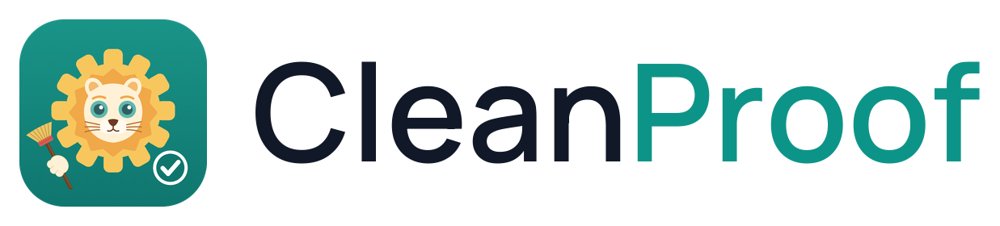
</picture>

**CleanProof is a physical AI software system that enables various robot platforms to clean intelligently.**

*Appropriate force. Varied surfaces. Proven clean.*

[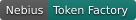](#built-with)
[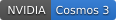](#built-with)
[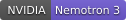](#built-with)
[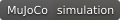](#how-it-works)
[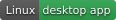](#using-the-software)
[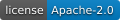](LICENSE)

[Demo video](https://youtu.be/zVJYgOz6nZ0) · [Download](#download) · [Quick start](#quick-start) · [Using the software](#using-the-software) · [Connect a real robot](#connect-a-real-robot) · [Technical report](docs/technical_report.md)

</div>

<p align="center">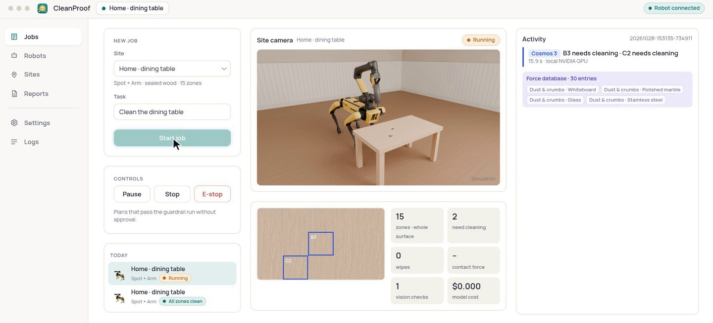</p>

Robots already clean floors, for example in Singapore's train stations, but they only wipe the floor. CleanProof lets a robot clean tables, counters and handrails, and check for itself that the surface is clean.

## What it does

- **Appropriate force.** Each stain gets a force chosen for the stain and the surface, and a zone that is still dirty gets a little more on the next wipe, up to the surface's limit.
- **Varied surfaces.** Each site records a clean reference once, so wood grain, stone speckle and steel shine are not mistaken for dirt.
- **Proven clean.** Every zone is checked again after each wipe, a job is never reported done while a zone is dirty, and stains that will not come off go to a person.

<table>
<tr>
<td width="33%">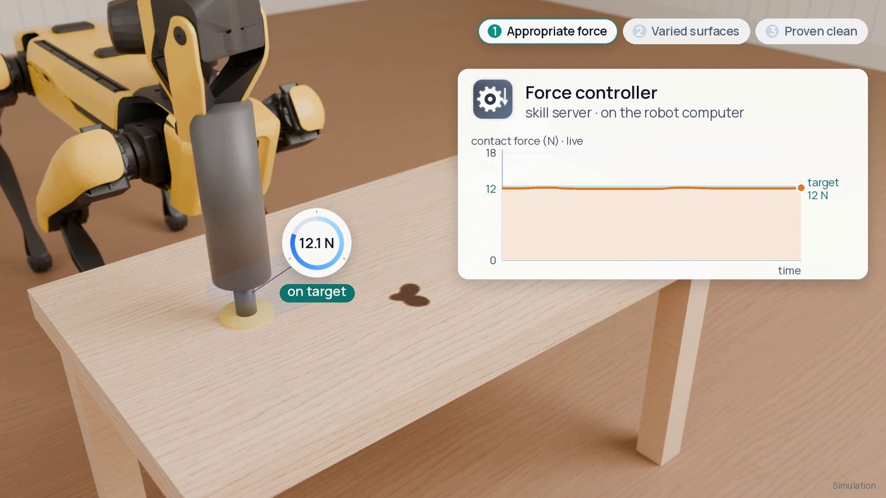</td>
<td width="33%">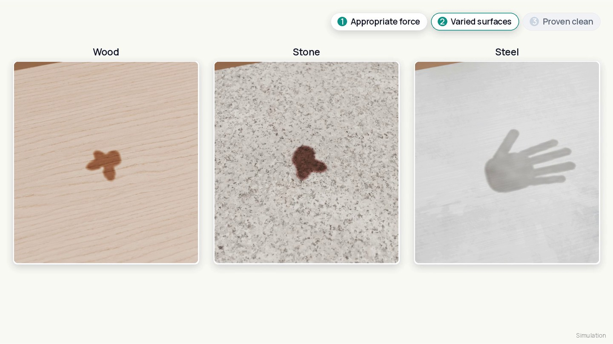</td>
<td width="33%">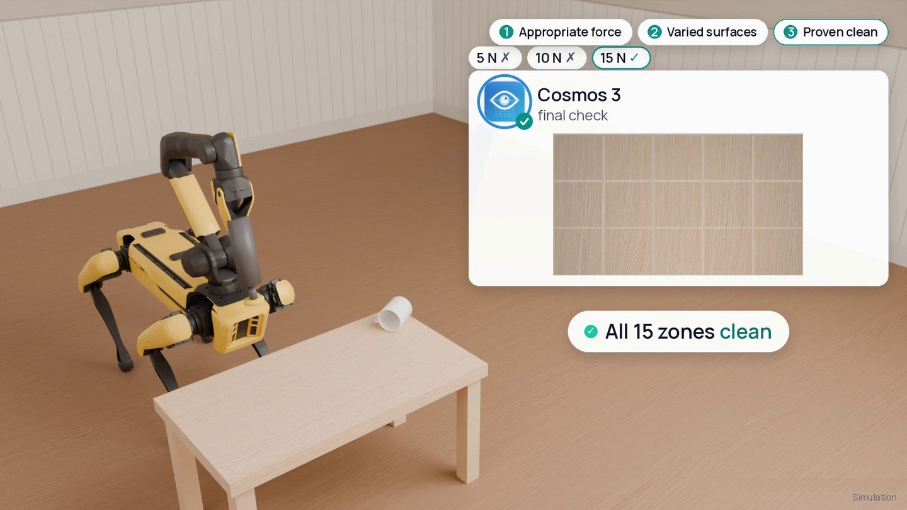</td>
</tr>
</table>

Benchmark results are in the [technical report](docs/technical_report.md).

## Download

Ubuntu 24.04 (x86-64): download `cleanproof_1.0.0_amd64.deb` from the [latest release](https://github.com/LBWSquare666/CleanProof-LBWSquare/releases/latest) and run `sudo apt install ./cleanproof_1.0.0_amd64.deb`, then start **CleanProof** from the application menu or with `cleanproof`. The release also has a Python wheel for `pip install`. To run from source instead, follow the Quick start.

## Quick start

Simulation only, no robot needed. Python 3.10 or newer on Linux.

```bash
git clone https://github.com/LBWSquare666/CleanProof-LBWSquare.git && cd CleanProof-LBWSquare
python -m venv .venv && . .venv/bin/activate
pip install -e ".[sim,ui]"

# Required: MuJoCo Menagerie, the robot models. The default site (home_dining) uses Spot + Arm,
# and the other example sites use UR5e, Franka Panda and Flexiv Rizon 4. Only a UR3e job runs without it.
# A full clone is about 2.3 GB, so clone only the latest snapshot:
git clone --depth 1 https://github.com/google-deepmind/mujoco_menagerie ../mujoco_menagerie
export CLEANPROOF_MENAGERIE=$PWD/../mujoco_menagerie
```

Start the software in a browser:

```bash
python -m cleanproof.ui.operator --site home_dining --sim-robot --pace 3
# then open http://127.0.0.1:8092
```

Or as a Linux desktop app:

```bash
sudo apt install python3-gi gir1.2-webkit2-4.1          # once
scripts/install/install_desktop.sh  # creates .venv-desktop and an app-menu launcher "CleanProof"
.venv-desktop/bin/python -m cleanproof.ui.desktop
```

With nothing paired, the robot is a built-in MuJoCo simulation. Open the Jobs page, pick a site and describe the task, and the job runs end to end.

The default job for `home_dining` uses the "stain that will not come off" template, so the first job always ends in a Staff check. This demonstrates the hand-off to a person: the stain is wiped up to the surface's force limit, then the job asks for staff, and you can resolve the request on the Jobs page. To see a job that finishes on its own, pick another site in the Jobs page drop-down (Car wash, Factory line or Office stairs, each with a stain that comes off), or set `job_scenario: H2_wood_coffee` in `configs/site/home_dining/site.yaml` to stay on Spot. The browser version scales the page to fit the window, so a small window is fine.

<details>
<summary><b>Full system: Nemotron on Token Factory + Cosmos 3</b></summary>

1. Put `NEBIUS_API_KEY=<your key>` in `~/.config/cleanproof/secrets.env` (readable only by you), or paste the key in the setup wizard.
2. Serve Cosmos 3 Nano on a local NVIDIA GPU (about 17 GiB of GPU memory). `GPU=0 scripts/install/install_edge.sh --site home_dining` installs the runtime and weights and starts it on port 8001. To restart it later: `GPU=0 scripts/server/serve_cosmos.sh`.
3. In the desktop app the planner and the zone check switch to Nemotron and Cosmos 3 automatically once the key is set and Cosmos answers on port 8001. In the browser, add `--policy nemotron --verifier vlm` to the operator command.
</details>

<details>
<summary><b>Developer commands</b></summary>

```bash
# Rule-based, no API key
python scripts/run_sim.py --scenario all --policy rules --verifier cv

# Another robot: spot_arm, ur5e, panda, rizon4 or ur3e
python scripts/run_sim.py --scenario S2_dried --policy rules --verifier cv --platform spot_arm

# Full system with audit (needs the API key and Cosmos 3)
python scripts/run_sim.py --scenario S2_dried --policy nemotron --verifier vlm --source render --audit

# HTML report for a finished run
python -m cleanproof.report runs/<run_id>
```
</details>

## Using the software

<table>
<tr>
<td width="50%">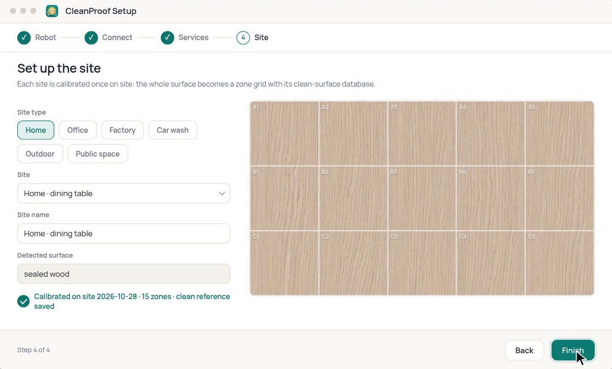<br><sub>Setup wizard</sub></td>
<td width="50%">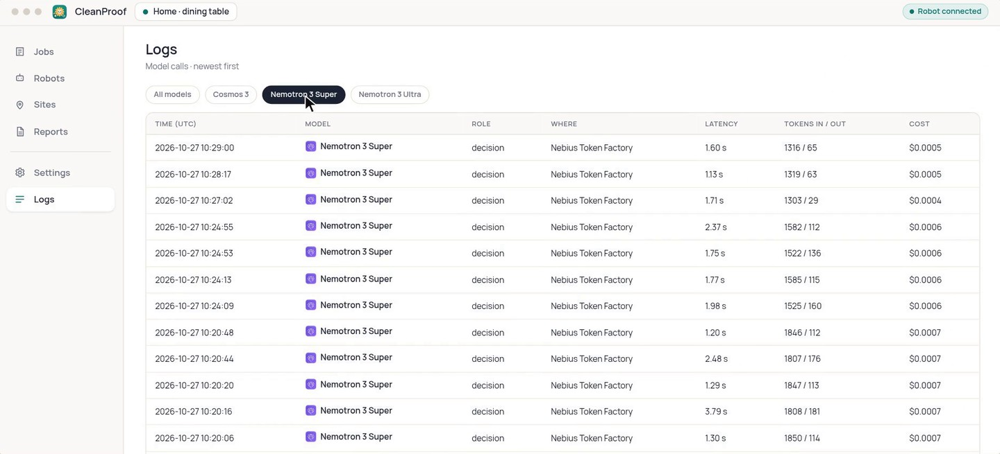<br><sub>Logs: every model call with its latency and cost</sub></td>
</tr>
<tr>
<td width="50%">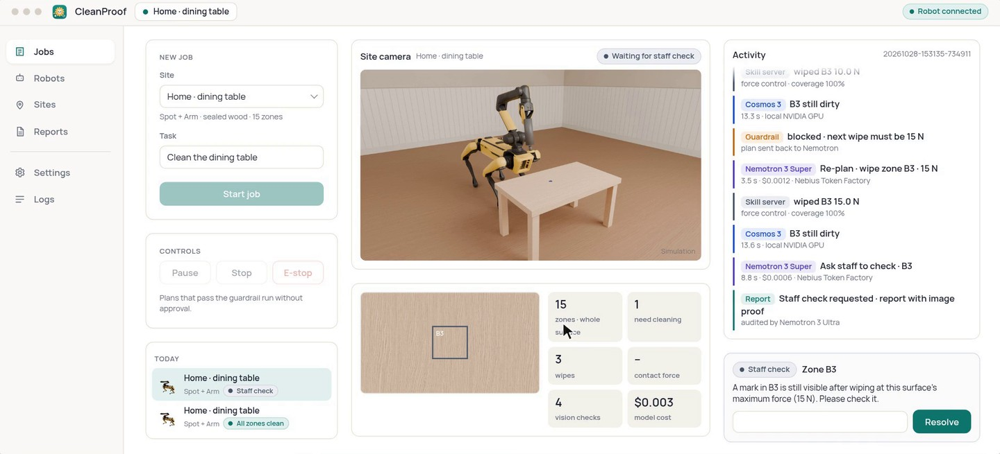<br><sub>Staff check</sub></td>
<td width="50%">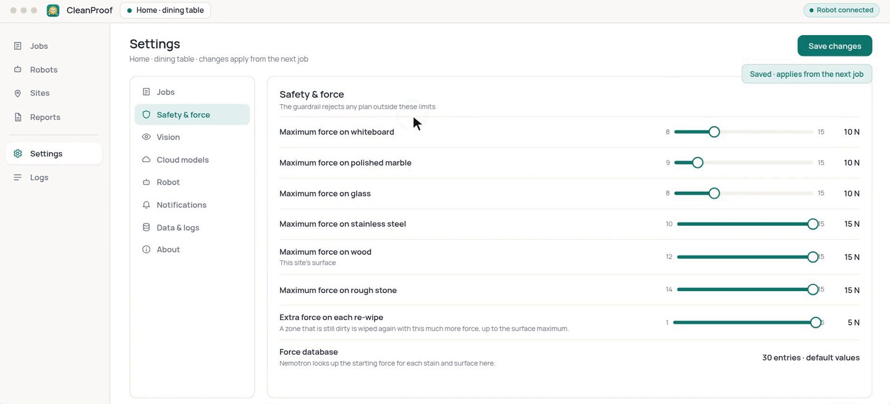<br><sub>Settings</sub></td>
</tr>
</table>

1. **Setup wizard.** Choose the robot, connect to it, check that every service is running, and calibrate the site.
2. **Start a job.** On Jobs, pick the site and write the task.
3. **Watch it run.** The zone map and the activity log show progress. You can pause, resume, stop or E-stop at any time.
4. **Staff checks.** A stain that will not come off at the surface's force limit is handed to a person, and their notes go into the report.
5. **Reports and Logs.** Reports shows before and after images for every zone that was wiped or handed to a person (the other zones are listed with their final state, plus whole-table images from the start and the end), and Logs shows every model call with its latency and cost.
6. **Settings.** Set the maximum force per surface, wipes per zone, plan approval, no-wipe zones and the spending limit.

## Connect a real robot

CleanProof runs on two machines: a GPU workstation on site (operator software, orchestrator and Cosmos 3) and the robot computer (skill server and camera service), linked by an encrypted SSH tunnel with a shared token.

```bash
# 1. GPU workstation: environment, Cosmos 3 runtime and weights, shared token, CleanProof as a user service
GPU=0 scripts/install/install_edge.sh --site home_dining

# 2. Robot computer (code synced with scripts/robot_pc/sync_to_robot_pc.sh or cloned):
#    environment, camera service and skill server. The skill server starts in shadow mode, so the robot does not move
scripts/install/install_robot.sh --backend ur3e --site ur3e_site

# 3. GPU workstation: copy the shared token, start the encrypted link, run the deployment checks
scripts/install/install_edge.sh --pair <robot-computer-ssh-host>

# 4. Start the software and follow the setup wizard: robot, connection, services, site calibration
```

Add `--dry-run` to any install script to preview it. UR arms are brought up in stages, and a person on site has to confirm each stage. Details are in the [technical report](docs/technical_report.md) (section 6.4).

## Supported robots

Many robots, from fixed arms to a quadruped with an arm, work through software adapters. Choose yours in the setup wizard; the list is in [`configs/platforms.yaml`](configs/platforms.yaml).

<p align="center">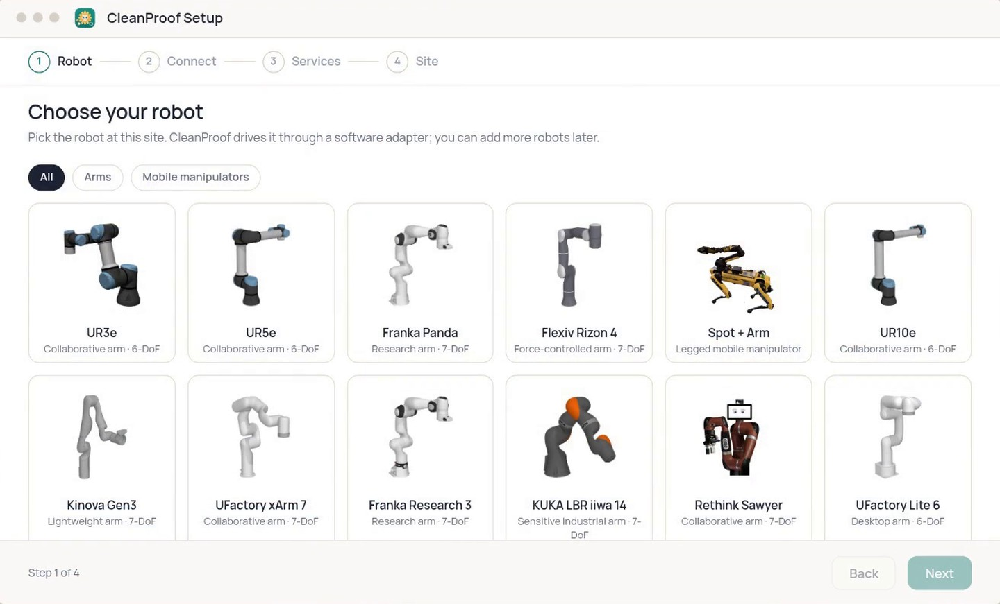</p>

## How it works

<p align="center">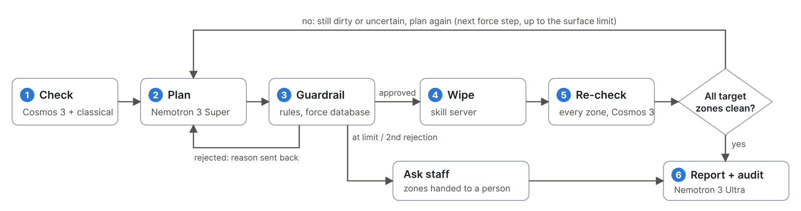</p>

- **Check.** The site camera is split into a calibrated zone grid, and Cosmos 3 labels each zone clean, residue or uncertain.
- **Plan.** Nemotron 3 Super returns one decision per step: which zones, what force, which wipe pattern, or ask a person.
- **Guardrail.** Rule checks compare the plan with the job, the no-wipe zones and the force database before anything moves.
- **Wipe and re-check.** The robot runs only whitelisted skills through a skill server, then every target zone is checked again.
- **Report.** Each job ends with an HTML report, and Nemotron 3 Ultra can audit the record.

## Built with

- **NVIDIA Cosmos 3 Nano** checks every zone against the site's clean reference, on a local NVIDIA GPU.
- **NVIDIA Nemotron 3 Super** plans each step, on Nebius Token Factory.
- **NVIDIA Nemotron 3 Ultra** audits each finished job, on Nebius Token Factory.

## License and credits

CleanProof is licensed under [Apache-2.0](LICENSE).

- **Robot models.** [MuJoCo Menagerie](https://github.com/google-deepmind/mujoco_menagerie), each under its own license.
- **Robot photos.** Wikimedia Commons: Spot with arm by Mojmir Churavy (CC0 1.0) and Sawyer by RT Robotics (CC BY-SA 4.0, background removed, shared under the same license), see [`assets/robots_photos/SOURCES.md`](assets/robots_photos/SOURCES.md).
- **Surface textures.** Poly Haven (grey oak veneer, CC0) and ambientCG (Granite002A, Metal011, CC0), see [`assets/surfaces/README.md`](assets/surfaces/README.md). HDRI "blinds" by Greg Zaal (Poly Haven, CC0).
- **Fonts.** Open-licensed, see [`assets/fonts/`](assets/fonts).
- **Narration voice.** Kokoro-82M (Apache-2.0).
- **Background music.** Original, synthesized in code by the team.

---

<sub>Built by team LBWSquare for the [Nebius × NVIDIA Global AI Hackathon](https://nebiusglobalaihackathon.devpost.com/), Physical AI track.</sub>
