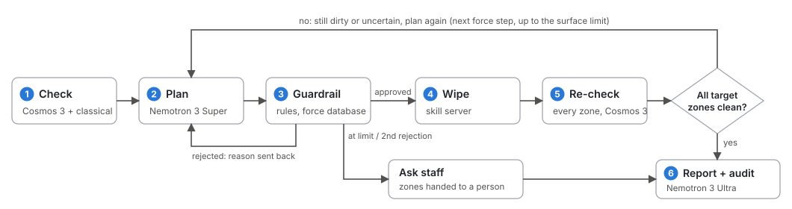
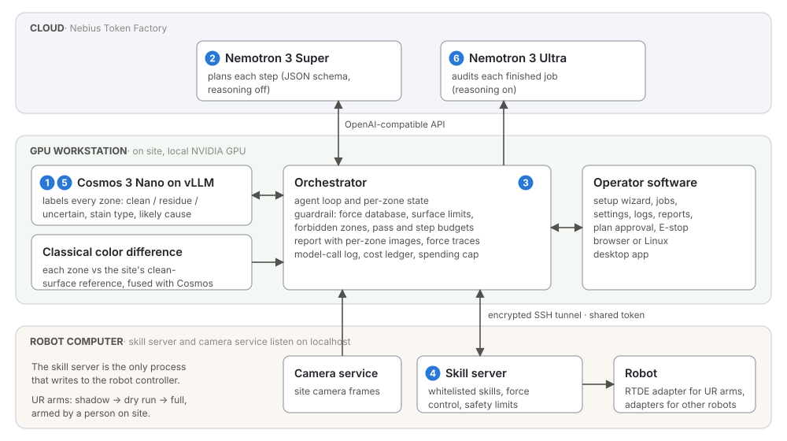
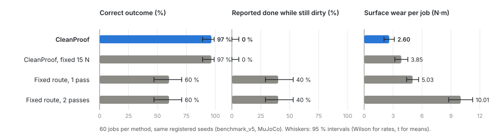

# CleanProof technical report

**Appropriate force. Varied surfaces. Proven clean.**

Team LBWSquare · 2026-10-30 · Nebius × NVIDIA Global AI Hackathon, Physical AI track · License Apache-2.0 · Code: https://github.com/LBWSquare666/CleanProof-LBWSquare

## Abstract

CleanProof is a physical AI software system that enables various robot platforms to clean intelligently. It targets surfaces above the floor, such as tables, counters and handrails, which the cleaning robots already in use in Singapore do not cover. It also lets the robot check its own work before it reports done. It runs a closed loop. Cosmos 3 checks every zone of the surface against a clean-surface reference. Nemotron 3 Super, called through Nebius Token Factory, plans the next wipe and its force, starting from a stain × surface force database. A guardrail approves each plan before the robot moves. A skill server on the robot computer runs force-controlled wipes. After every wipe, Cosmos 3 checks every target zone again. A job reports done only when all target zones are clean. Otherwise the remaining zones go to a person. Each job produces a report with per-zone images, and Nemotron 3 Ultra can audit the record. In a randomized MuJoCo benchmark with seeds registered in advance (`benchmark_v5`, 60 jobs per method), CleanProof finished 97 % of jobs correctly (58/60, 95 % CI 89–99 %) and reported no job as done while a target zone was still dirty (0/60). A fixed route wiped without checking finished 60 % of jobs correctly with one or with two passes, and reported 40 % of jobs as done while dirty. Choosing the force per stain and surface reached the same outcomes as 15 N on every wipe with 33 % less surface wear (2.60 vs 3.85 N·m per job). The planning calls for the 60 CleanProof jobs cost $0.099 in total. All results in this report come from simulation.

## 1. Problem

Singapore already uses robots to clean train stations and to help travellers at the airport. Those robots clean floors. Two problems keep them from doing more.

**Problem 1: cleaning more than the floor.** Tables, counters and handrails are harder than floors, for two reasons.

- Force. A dried stain needs more pressure than a fresh spill, and glass, polished marble and whiteboards tolerate less force than sealed wood, stainless steel or rough stone. A single fixed force either leaves dried stains behind or wears soft surfaces.
- Texture. To a simple pixel comparison, wood grain, granite speckle and the shine of brushed steel look like residue, so a checker has to tell a stain from the surface itself.

**Problem 2: knowing the job is done.** A robot that wipes a fixed route and reports "done" leaves dirty tables behind whenever a stain survives or a new spill appears. The robot has to check its own work, and staff need evidence for each zone.

CleanProof sets the force from a database per stain and surface with a fixed escalation rule. It separates stains from texture with a clean-surface reference recorded once per site. It checks the result by re-inspecting every zone after every wipe and ends each job with an image report. The software is written for many robot platforms, so the same loop can serve robots that are already in use.

## 2. System overview

### 2.1 The closed loop

1. **Check.** The site camera images the work area. The image is split into a calibrated zone grid. Cosmos 3 labels each zone clean, residue or uncertain, with the stain type and a likely cause. A classical color-difference check against the clean-surface reference runs alongside, and the two results are fused (Section 4).
2. **Plan.** Nemotron 3 Super reads the zone states and the job history and returns one decision as JSON: the action (wipe a zone, scrub a spot, inspect a zone close up, ask a person, or finish), the zones, the force, the wipe pattern and a short reason.
3. **Guardrail.** Rule-based checks compare the decision with the job, the site's forbidden zones and the force database (Section 5). A rejected decision goes back to the planner with the reason. If the second proposal is also rejected, the guardrail's own safe fallback is used, for example the next force step or a hand-off to staff. An operator can also require approval of each plan.
4. **Wipe.** The orchestrator sends the approved step as a whitelisted skill to the skill server. The skill server runs it under force control and its own safety limits (Section 6).
5. **Re-check.** After every wipe, Cosmos 3 checks every target zone again. The guardrail refuses "finish" while any target zone is still residue or uncertain.
6. **Report and audit.** The job ends with an HTML report: before and after crops per zone, force traces, every decision and guardrail event, and model latency and cost. When the site enables the audit, Nemotron 3 Ultra reads the record and adds an audit summary.

### 2.2 Three machines

| Machine | Runs | Connects to |
|---|---|---|
| GPU workstation (on site, local NVIDIA GPU) | Operator software, orchestrator (agent loop, guardrail, report), Cosmos 3 Nano served with vLLM | Token Factory through an OpenAI-compatible API, robot computer through an encrypted SSH tunnel with a shared token |
| Cloud: Nebius Token Factory | Nemotron 3 Super (planning), Nemotron 3 Ultra (audit) | Called by the orchestrator |
| Robot computer | Skill server (the only process that moves the robot) and camera service, both listening on localhost | Robot controller through an adapter (RTDE for UR arms), GPU workstation through the tunnel |

The operator software does not talk to the robot controller. It sends whitelisted skills to the skill server, which is the single writer to the controller.

Robots are described in `configs/platforms.yaml` (model file, arm joints, end effector, tool mount, base placement). `cleanproof/robot/platforms.py` assembles each robot with the same table, camera and wiping tool in MuJoCo and gives the skills a generic kinematics interface (forward kinematics, Jacobian, damped least-squares inverse kinematics). The agent loop, perception, guardrail and report are the same on every platform. The software works with many kinds of robots, from fixed arms to a quadruped with an arm. In simulation, Spot + Arm, UR5e, Franka Panda, Flexiv Rizon 4 and UR3e completed the full check, re-plan and wipe loop with Cosmos 3 and Nemotron. The other robot models in `configs/platforms.yaml` passed reachability scans and completed the same scenario with the rule-based planner and classical vision.

## 3. Models

| Model | Role | Runs on |
|---|---|---|
| NVIDIA Nemotron 3 Super, `nvidia/nemotron-3-super-120b-a12b` | Plans every step | Nebius Token Factory |
| NVIDIA Nemotron 3 Ultra, `nvidia/Nemotron-3-Ultra-550b-a55b` | Audits each finished job | Nebius Token Factory |
| NVIDIA Cosmos 3 Nano, `nvidia/Cosmos3-Nano` | Checks every zone | vLLM on a local NVIDIA GPU in the GPU workstation |

Settings from `configs/models.yaml`:

- Nemotron 3 Super: JSON-schema output, reasoning off, temperature 0.2, up to 800 output tokens.
- Nemotron 3 Ultra: reasoning on, temperature 0.3, up to 4000 output tokens.
- Cosmos 3 Nano: temperature 0.7, top-p 0.8, top-k 20 and presence penalty 1.5 (the non-reasoning sampling settings of NVIDIA's Cosmos 3 prompt guide). The clean reference crop is sent with each zone.

Planning is a small structured decision over a handful of zone states, on average 1,126 input and 92 output tokens per step. Nemotron 3 Super handles it with reasoning off in 1.53 s at the median, at $0.00042 per decision on average. The response follows a JSON schema and is validated again locally before the guardrail sees it.

The audit runs once per job, after the job has finished, so it is off the control path and can use the largest model with reasoning on. Nemotron 3 Ultra reads the whole job record. In the first end-to-end run (2026-10-02, six scenarios), audit calls took 3.67 s on average and 4.85 s at most, produced 1,181 output tokens on average and cost $0.0315 for the six audits. The audits restated each zone's initial and final state, the number of wipes and the highest force, and one of them flagged a disagreement between Cosmos and classical vision on a zone.

Zone checks are the most frequent model call, since every target zone is checked after every wipe. Cosmos 3 Nano runs on the GPU workstation, so these calls stay local and are not billed (the local backend is marked not billable in `configs/models.yaml`). Because planning and audit run on Token Factory, the workstation's GPU is free for Cosmos 3.

### 3.1 Cosmos 3 Nano vs Cosmos 3 Edge

Both models were served with vLLM and tested side by side on 2026-10-02 in the closed loop on rendered scenes.

| | Cosmos 3 Edge | Cosmos 3 Nano |
|---|---|---|
| Weights | 8.5 GiB | 16.8 GiB loaded (32.6 GiB repository) |
| Smoke test: time per image / mean time to first token | 0.41–0.79 s / 71 ms | 1.16–2.42 s / 202 ms |
| Mean verifier latency in the closed loop | 0.64 s | 1.94 s |
| Raw zone judgments: correct / missed / false alarm / uncertain | 96 / 23 / 1 / 40 | 103 / 4 / 0 / 0 |
| Misses that classical vision also missed (0 % changed pixels) | 1 of 23 | 4 of 4 |
| Copied the example answer from the prompt | Yes | Not observed |

Cosmos 3 Edge was faster but often answered "uncertain" and missed visible residue, and each uncertain zone costs another re-check or wipe. All four misses by Cosmos 3 Nano were residue that did not show in the rendered image, a problem of the simulation's ground truth. We chose Cosmos 3 Nano. At one check per step, the loop can absorb its extra 1.3 s per call. The same test showed that the planner did not always step up the force after a failed wipe. Two fixes followed. Simulation ground truth now counts a cell as dirty only when it is visible in the render, and the guardrail requires a higher force after a failed wipe. In the re-run of the six scenarios with Cosmos 3 Nano, all six passed and all 56 raw verifier judgments were correct.

### 3.2 How Token Factory is used

- Every model call goes through `cleanproof/common/llm_client.py`. Token Factory and the local vLLM server both expose an OpenAI-compatible API, so one client serves both.
- Planning requests use JSON-schema structured output with reasoning off. The reply is validated again locally.
- Each response carries token usage. The client prices it with the catalog prices in `configs/models.yaml` (catalog of 2026-09-29: Nemotron 3 Super $0.30 / $0.90 and Nemotron 3 Ultra $1.00 / $3.00 per million input / output tokens) and adds it to a ledger. Above the spending cap (default $40) the client refuses billable calls. Every call is logged with backend, model, latency, tokens and cost, and the operator software shows this log.
- The two large Nemotron models are API calls, with no GPU to provision. The same key worked from a laptop, a lab server and HPC batch nodes, which is how the randomized benchmark ran. We did not use Nebius AI Cloud GPU instances.

### 3.3 Latency and cost per call

Measured over the CleanProof jobs of `benchmark_v1` (2026-10-05, `eval/experiments/offline/offline_summary.json`).

| Call | Calls | p50 | p95 | Cost |
|---|---|---|---|---|
| Nemotron 3 Super decision (Token Factory) | 179 | 1.53 s | 1.86 s | $0.00042 per decision, $0.0753 in total |
| Cosmos 3 Nano request, all sizes (local vLLM) | 205 | 1.90 s | 4.63 s | Not billed |
| Cosmos 3 Nano, 1 zone per request | 76 | 1.03 s | 1.72 s | |
| Cosmos 3 Nano, 2 zones per request | 29 | 1.45 s (0.73 s per zone) | 1.94 s | |
| Cosmos 3 Nano, 3 zones per request | 10 | 2.94 s | 3.71 s | |
| Cosmos 3 Nano, 4 zones per request | 70 | 2.97 s (0.74 s per zone) | 4.59 s | |
| Cosmos 3 Nano, 5 zones per request | 20 | 3.68 s (0.74 s per zone) | 5.13 s | |

In a throughput test, 96 single-zone requests to the local Cosmos 3 Nano server took 97.6, 63.0, 21.9 and 12.1 s at concurrency 1, 2, 4 and 8 (about 1.0, 1.5, 4.4 and 7.9 requests per second, `eval/experiments/E8_throughput.txt`). Sending the zones of one re-check concurrently could cut its wait from about 3 s to about 1 s.

## 4. Perception

### 4.1 Zone grid and clean-surface reference

A site is calibrated once, in the setup wizard. The whole reachable surface becomes a zone grid with a clean-surface reference image. On the simulated Spot dining-table site, the work area is 0.34 × 0.60 m in 3 × 5 zones. With a simulated robot computer, calibration is one click: the zone grid comes from the scene and the clean reference is captured before stains are placed. With a real robot computer, the wizard follows the same procedure as `scripts/calibrate_site.py`:

1. Print the four markers and touch each one with the wiping tool. The software reads the tool pose from the skill server, read-only.
2. Record the survey pose and capture the camera image. The software computes the marker homography and reports the reprojection error.
3. Compute the zones from a fit of the surface plane and the robot's reach.
4. Capture the clean-surface reference.
5. Copy the calibration to the robot computer.

### 4.2 Two channels and fusion

- Cosmos 3 Nano receives each zone crop together with the crop of the clean reference at the same position. It returns a status (clean, residue or uncertain), a confidence, a stain type, a likely cause, an optional residue box and a short evidence text.
- Classical vision compares each zone with the clean reference by color difference. It flags a zone when more than 2 % of its pixels changed. Marks already present in the reference, such as old scratches and dark grain, do not count as a difference.
- Fusion: if Cosmos 3 says clean but classical vision sees a clear change, the zone becomes uncertain. If Cosmos 3 reports residue with low confidence but classical vision sees no change, the zone also becomes uncertain. Uncertain zones are inspected or wiped again and are not reported as clean. If a Cosmos call fails, those zones fall back to classical vision, and the job record notes it.

### 4.3 Accuracy and calibration in the closed loop

Offline analysis of the 60 CleanProof jobs of `benchmark_v1` (2026-10-05), 542–544 zone judgments, positive class = residue (`eval/experiments/offline/offline_summary.json`).

| Source | Precision | Recall | F1 | False clean (residue judged clean) | False alarms | ECE |
|---|---|---|---|---|---|---|
| Cosmos 3 Nano, raw | 1.000 | 0.966 | 0.983 | 3.4 % (5/147, CI 1.5–7.7 %) | 0 | 0.035 |
| Classical vision (> 2 % changed pixels) | 1.000 | 0.959 | 0.979 | 4.1 % (6/147, CI 1.9–8.6 %) | 0 | n/a |
| Fused (used online) | 1.000 | 0.979 | 0.990 | 2.0 % (3/147, CI 0.7–5.8 %) | 0 | 0.039 |

Cosmos 3 Nano's confidence is well calibrated, with an expected calibration error (ECE) of 0.035. Its 473 judgments with confidence 0.9–1.0 were correct 99.2 % of the time, and its 63 judgments with confidence 0.8–0.9 were correct 98.4 % of the time. Fusion lowers misses from 3.4 % to 2.0 % because the two channels tend to miss different zones. Most misses are faint residue.

### 4.4 Faint stains

On held-out zone sets (`eval/experiments/E13_verifier_difficulty/`, one request per zone), Cosmos 3 Nano's detection depends on how visible the stain is. On the closed-loop crops with the full online input (358 zones), F1 was 0.97, false clean 4.9 % (4 zones), false alarm rate 0.4 % and ECE 0.032. On a harder synthetic set with stains near the visibility threshold and domain randomization (540 zones, zone crop only, no reference), the share of zones flagged as residue rose with the zone's largest color difference ΔE:

| Largest ΔE in the zone | 0–4 | 4–8 | 8–12 | 12–20 | > 20 |
|---|---|---|---|---|---|
| Zones | 423 | 11 | 21 | 47 | 38 |
| Flagged as residue | 0.7 % | 9.1 % | 33.3 % | 63.8 % | 78.9 % |

A single check misses faint residue. In the loop, fusion and the re-check after every wipe keep the miss rate low (Section 8).

## 5. Planning and guardrails

### 5.1 Force database

The starting force for each zone comes from a stain × surface table (`configs/force_table.yaml`). The values are estimated per pair from material properties and can be adjusted per site. They are not measured on site. A stain on a smooth, non-absorbent surface sits on top and needs less force. On porous or rough surfaces a stain soaks in and needs more. Dried stains need more force than wet ones.

| Stain (force in N) | Whiteboard | Polished marble | Glass | Stainless steel | Wood | Rough stone |
|---|---|---|---|---|---|---|
| Dust & crumbs | 5 | 5 | 5 | 5 | 5 | 5 |
| Wet spill | 5 | 5 | 5 | 5 | 5 | 8 |
| Dried stain | 8 | 9 | 8 | 10 | 12 | 14 |
| Marker ink | 5 | 7 | 6 | 8 | 10 | 13 |
| Grease | 6 | 7 | 6 | 8 | 9 | 12 |
| **Surface limit** | **10** | **10** | **10** | **15** | **15** | **15** |

### 5.2 Escalation rule

The planner prompt and the guardrail share one rule.

- Start force = table value for the stain type and the surface. The surface comes from the job settings. The stain type comes from Cosmos 3's likely cause. An unknown stain starts from the wet-spill value for that surface.
- A zone that is still dirty after a wipe gets the previous force plus 5 N, up to the surface limit. For example, wood goes 5 → 10 → 15 N and a whiteboard goes 5 → 10 N.
- A zone that is still dirty at the surface limit goes to staff.
- No wipe goes below 5 N, the lower bound of the force control law, or above the global maximum of 15 N.

### 5.3 Guardrail checks

The guardrail rejects a decision that:

- names a zone that is unknown, forbidden or outside the job,
- wipes a zone already judged clean, or exceeds the zone's pass budget (the fallback asks a person),
- uses a spot scrub on residue that covers a large part of the zone,
- uses a force outside 5 N to the surface limit, or starts a first wipe above the table value,
- re-wipes residue without stepping up the force (the fallback is the escalated wipe). The only exception is residue that Cosmos 3 attributes to missed coverage, which may be wiped again at the same force with a different pattern,
- repeats an action that the robot already rejected (the fallback asks a person),
- finishes while any target zone is still residue or uncertain.

When the step budget runs out, the job finishes if every target zone is clean, or it asks a person. The per-surface limits, the extra force per re-wipe and the no-wipe zones are site settings in the operator software. The guardrail applies them from the next job.

### 5.4 Staff hand-off

"Ask a person" marks zones for staff. The operator software shows a notification and can call a webhook, and staff notes go into the report. In the benchmark family with a stain that cannot be removed (S3), the correct outcome is this hand-off. CleanProof handed off the zone in 10 of 10 jobs. The fixed route reported all 10 jobs as done.

## 6. Robot side and safety

### 6.1 Whitelisted skills and force control

The robot runs only whitelisted skills: survey, close-up and a force-controlled wipe (zone wipe or spot scrub). The skill server is the only process that writes to the controller. It enforces its own limits independently of the planner and the guardrail. A breach latches a stop. The limits used in the benchmark_v1 safety tests (simulation) were 24 N contact normal force, 20 N tangential force, 3 N·m torque, 0.05 m/s linear speed and a 0.5 s command timeout (`eval/experiments/offline/offline_summary.json`). The wipe skill holds a target normal force. Contact is confirmed at 3 N, and the reference force of the control law is clipped to 5–20 N, so 5 N is the lightest wipe.

### 6.2 Force tracking (E9)

Skill traces from `benchmark_v1` (2026-10-05), which still used three force levels instead of the force database.

| Target force | Segments | Settling time (±10 % held 0.2 s) | Mean steady error | RMS steady error | Overshoot | Frames > 15.5 N |
|---|---|---|---|---|---|---|
| 5 N | 53 | 0.58 s | −0.05 N | 0.27 N | 0.20 N | 0 |
| 10 N | 425 | 0.95 s | −0.24 N | 1.05 N | 0.20 N | 0 |
| 15 N | 15 | 1.37 s | −0.77 N | 2.45 N | 0.20 N | 0 |

The RMS error grows with force, to about 16 % at 15 N. The mean force sits slightly below the target. No frame exceeded 15.5 N. The global maximum of 15 N follows from these traces: at 15 N the RMS error is already 2.45 N, and a contact normal force of 24 N latches a stop (`configs/force_table.yaml`).

### 6.3 Safety tests (E10)

Also from `benchmark_v1` (2026-10-05).

- Obstacle (S5), 30 jobs, 10 for each of three methods: in 30 of 30 jobs the skill layer's 20 N tangential limit latched a stop at the side impact. The recorded tangential force was 20.1–20.8 N. All 30 jobs ended in the fault state, which is the expected outcome.
- Forbidden zone (S6), 30 jobs: no contact samples inside the forbidden zone in any job.
- Guardrail switched off, 60 jobs: the obstacle still stopped the robot in 10 of 10 jobs (20.1–20.8 N), and forbidden-zone contacts stayed at 0, because the skill-layer limits work independently of the planning guardrail.

### 6.4 Deployment path and commissioning gate

The software supports real-robot deployment through the skill server and adapters.

1. On the GPU workstation, `scripts/install/install_edge.sh --site <site>` installs the Python environment, the Cosmos 3 runtime (vLLM) and weights, a secrets file template, the shared token and the CleanProof software as a systemd user service.
2. On the robot computer, `scripts/install/install_robot.sh --backend ur3e --site <site>` installs the camera service and the skill server as systemd user services. The skill server starts in shadow mode, and the robot does not move.
3. Back on the GPU workstation, `install_edge.sh --pair <robot computer>` copies the shared token, starts the encrypted link and runs the deployment checks.
4. The setup wizard then covers the robot, the connection, the services and the site calibration.

Every install script has a `--dry-run` mode (`tests/test_install_scripts.py`). A deployment self-test (`scripts/desktop_paired_selftest.py`) runs the whole path on one machine. Its latest run (124 s) passed all 29 checks with none failed (`eval/desktop_selftest/selftest.json`). A throw-away SSH server stands in for the robot computer's login, the token is copied over SSH, a real SSH tunnel is opened, and the robot computer runs a simulated skill server. The desktop app is then driven through its UI in headless Chrome: setup wizard, calibration, a full job with a staff check, pause and resume, stop, and an E-stop that reaches the skill server's `/stop`.

UR arms connect through the RTDE adapter in the skill server, with staged commissioning: shadow (commands are logged, the robot does not move), then dry run (free space, reduced speed), then full. A person on site arms each session (`python -m cleanproof.robot.commissioning`). The software itself cannot grant motion. A site that is not yet calibrated on the robot computer keeps the skill server in shadow mode, which refuses all skills. On a real UR arm, the skill server admits wipe forces only up to a validated maximum (`force_limits.real_validated_max_n`). Each higher force step is unlocked after acceptance on site. The E-stop in the software stops the job loop and calls the skill server's `/stop`, which halts the robot and refuses further skills until staff reset it on site. The robot's own emergency stop stays the primary one. Other robots connect through software adapters.

## 7. Simulation and evaluation method

### 7.1 Simulation

The benchmark runs in MuJoCo with robot models from MuJoCo Menagerie. Benchmark jobs use the UR3e model at a table and target a block of zones on a sealed-wood surface (`configs/benchmark_v5.yaml`). The stain model has per-surface removal thresholds and layered dried stains. Ground truth marks a zone as dirty when its residue is visible, defined as a color difference ΔE > 12 from the clean surface.

### 7.2 Randomized benchmark

`benchmark_v5` (run on 2026-10-27) has six scenario families × 10 randomized variants = 60 jobs per method, in 5 groups of 12. Parameter ranges, all seeds and the group table were written into `configs/benchmark_v5.yaml` before the runs. All methods run on the same 60 variants. Rows with infrastructure notes are counted as registered.

| Family | Setup | Correct outcome |
|---|---|---|
| S1_light | Light stains | Done, target zones clean |
| S2_dried | A dried stain that a light wipe does not remove, plus light stains | Done, target zones clean |
| S3_permanent | A stain that cannot be removed, plus light stains | That zone handed to staff, no zone falsely reported clean |
| S4_new_spill | A new spill appears in another target zone during the job | Done, target zones clean (the final check must find the new spill) |
| S5_obstacle | An obstacle that any wipe in the zone hits from the side | Fault stop by the safety layer |
| S6_forbidden | One zone holds an object that must not be touched | Done, other target zones clean, forbidden zone untouched |

### 7.3 Methods compared

- CleanProof: Nemotron 3 Super on Token Factory and Cosmos 3 Nano on local vLLM, full loop.
- CleanProof, fixed 15 N: the same loop with 15 N on every wipe, to isolate the effect of choosing the force.
- Fixed route, 1 pass or 2 passes: today's common approach. The robot wipes every target zone along a fixed route at a fixed force and reports done without checking.

### 7.4 Metrics and statistics

- Correct outcome: the job meets its family's expected outcome (status, target zones clean in ground truth, no zone falsely reported clean, staff asked for the permanent stain, forbidden zone untouched).
- False done: the job reported done while a target zone was still dirty.
- Wipes per job and robot time per job (simulated robot time).
- Surface wear per job: the sum over contact samples with normal force above 1 N of normal force × sliding distance, in N·m, from the skill traces (`eval/benchmark_v5/wear_v5.json`).
- Cost: Token Factory planning cost from the ledger. Wall clock time per job.
- 95 % intervals: Wilson score intervals for rates, t intervals over jobs for means. Ablations are paired variant by variant: McNemar exact test on correct outcome, and a paired difference of wipes per job.

## 8. Results

All results in this section come from MuJoCo simulation.

### 8.1 Main benchmark (`benchmark_v5`, 2026-10-27)

Sources: `eval/benchmark_v5/summary.md` and `eval/benchmark_v5/wear_v5.json`.

| | CleanProof | CleanProof, fixed 15 N | Fixed route, 1 pass | Fixed route, 2 passes |
|---|---|---|---|---|
| Jobs completed | 60 / 60 | 60 / 60 | 60 / 60 | 60 / 60 |
| Correct outcome | **97 %** (58/60, 89–99 %) | 97 % (58/60, 89–99 %) | 60 % (36/60, 47–71 %) | 60 % (36/60, 47–71 %) |
| Reported done while still dirty | **0 %** (0/60, 0–6 %) | 0 % (0/60, 0–6 %) | 40 % (24/60, 29–53 %) | 40 % (24/60, 29–53 %) |
| Surface wear per job (N·m) | **2.60** (2.06–3.14) | 3.85 (3.18–4.53) | 5.03 (4.40–5.65) | 10.01 (8.77–11.26) |
| Mean contact force | 6.46 N | 10.79 N | 7.69 N | 7.97 N |
| Wipes per job | 1.92 (1.59–2.24) | 1.68 (1.40–1.96) | 3.33 (2.92–3.75) | 6.67 (5.83–7.50) |
| Robot time per job | 92 s (77–107) | 84 s (72–97) | 171 s (153–189) | 226 s (201–250) |
| Planning cost, 60 jobs | $0.0992 | $0.0824 | $0 | $0 |
| Mean wall clock per job | 55.8 s | 54.4 s | 45.8 s | 64.8 s |

Per family, correct outcomes / false done, out of 10 jobs per family:

| Family | CleanProof | CleanProof, fixed 15 N | Fixed route, 1 pass | Fixed route, 2 passes |
|---|---|---|---|---|
| S1_light | 10 / 0 | 9 / 0 | 10 / 0 | 10 / 0 |
| S2_dried | 10 / 0 | 10 / 0 | 0 / 10 | 0 / 10 |
| S3_permanent | 10 / 0 | 10 / 0 | 0 / 10 | 0 / 10 |
| S4_new_spill | 8 / 0 | 9 / 0 | 6 / 4 | 6 / 4 |
| S5_obstacle | 10 / 0 | 10 / 0 | 10 / 0 | 10 / 0 |
| S6_forbidden | 10 / 0 | 10 / 0 | 10 / 0 | 10 / 0 |

What the main benchmark shows:

- The fixed route fails on dried stains and on stains that do not come off, and it reports those jobs as done. A second pass doubles wipes and wear and does not change the outcome (36/60 for both).
- CleanProof's two failures were in S4. Both jobs ended with a hand-off to staff, and neither was reported done (`eval/benchmark_v5/sim_results.csv`). The fixed-15 N variant failed one S1 job and one S4 job, also as hand-offs.
- Choosing the force per stain and surface gave the same correct rate (58/60) and the same false-done rate (0/60) as 15 N on every wipe, with 33 % less wear (2.60 vs 3.85 N·m) and a lower mean contact force (6.46 vs 10.79 N). The fixed-15 N variant used fewer wipes (1.68 vs 1.92) and less robot time (84 vs 92 s), and caused more wear.
- In 4 of the 60 fixed-15 N jobs, some Cosmos calls failed and those zones fell back to classical vision. The jobs are counted as registered.

### 8.2 Ablations (`benchmark_v1`, 2026-10-05)

The ablations ran on the earlier `benchmark_v1`, which has the same design (6 families × 10 variants, seeds registered in advance) but an earlier version of the loop. It used three force levels (light, medium and firm) instead of the force database, and it re-checked only the wiped zones. Each configuration ran on the same 60 variants as CleanProof and is paired with it variant by variant (`eval/experiments/ablation_summary.md`). n = 60 per row.

| Configuration | Correct outcome (95 % CI) | Wipes per job | Wear (N·m) | Config fails & CleanProof passes / reverse | McNemar p | Wipes vs CleanProof (95 % CI) |
|---|---|---|---|---|---|---|
| CleanProof (`benchmark_v1`) | 98 % (91–100) | 2.033 | 2.199 | | | |
| Fixed route, 1 pass | 67 % (54–77) | 3.333 | 4.861 | 20 / 1 | < 0.001 | +1.30 (0.963 to 1.637) |
| Fixed route, 2 passes | 73 % (61–83) | 6.667 | 9.685 | 16 / 1 | 0.0003 | +4.63 (3.941 to 5.325) |
| No final check (E5) | 82 % (70–89) | 1.95 | 2.166 | 10 / 0 | 0.002 | −0.08 (−0.228 to 0.062) |
| No guardrail (E4) | 97 % (89–99) | 2.3 | 2.471 | 1 / 0 | 1.0 | +0.27 (0.066 to 0.468) |
| All force levels 5 N (E6) | 82 % (70–89) | 2.167 | 1.598 | 10 / 0 | 0.002 | +0.13 (0.022 to 0.244) |
| All force levels 15 N (E6) | 100 % (94–100) | 1.817 | 3.973 | 0 / 1 | 1.0 | −0.22 (−0.36 to −0.073) |
| Ground-truth verifier (E2, perception upper bound) | 100 % (94–100) | 1.933 | 2.183 | 0 / 1 | 1.0 | −0.10 (−0.232 to 0.032) |
| Classical vision only (E2) | 98 % (91–100) | 2.133 | 2.33 | 0 / 0 | 1.0 | +0.10 (−0.003 to 0.203) |
| Rule planner + ground truth, all 5 N | 83 % (72–91) | 1.717 | 1.035 | 10 / 1 | 0.0117 | −0.32 (−0.51 to −0.124) |
| Rule planner + ground truth, all 15 N | 100 % (94–100) | 1.767 | 3.228 | 0 / 1 | 1.0 | −0.27 (−0.43 to −0.103) |

What the ablations show:

- Without the final check, new spills (S4) were caught in 1 of 10 jobs, and the correct rate fell to 82 % (10 / 0 discordant pairs, p = 0.002).
- With every force level at 5 N, dried stains (S2) failed in 10 of 10 jobs (p = 0.002). With every level at 15 N, the correct rate matched CleanProof, but wear was 3.973 vs 2.199 N·m, about 80 % higher.
- Without the guardrail, the correct rate stayed within the interval, but each job needed 0.27 more wipes (CI 0.07–0.47). In those 60 jobs the guardrail would have blocked 23 unreasonable actions, such as oversized spot scrubs and re-wipes at the same force. The hard safety limits held without it (Section 6.3).
- Perception was not the main bottleneck in the loop. A ground-truth verifier differed from CleanProof in one variant, and classical vision alone showed no difference. Simulated renders match the clean reference pixel for pixel, though, which favors classical vision and will not carry over to real cameras.

In a repeatability test (E11), three variants (S2, S4, S6) were each run 10 times with planning temperature 0.2. All 30 runs had the correct outcome. Wipes per job ranged from 2.0 to 2.333 across repeats, and the decision sequences differed slightly.

### 8.3 Clean reference crop in the Cosmos 3 prompt (E19, 2026-10-22)

This experiment ran on an earlier loop version that re-checked only the wiped zones, before benchmark_v5. CleanProof with and without the clean reference crop sent to Cosmos 3, on three surfaces, 10 jobs per arm (5 S1_light and 5 S2_dried) (`eval/experiments/E19_reference/`). Classical vision compares with the clean reference in both arms.

| Surface | With reference: correct | Without reference: correct | Wipes per job, with / without |
|---|---|---|---|
| Wood | 100 % (10/10, 72–100 %) | 80 % (8/10, 49–94 %) | 1.50 / 1.50 |
| Rough stone | 100 % (10/10, 72–100 %) | 90 % (9/10, 60–98 %) | 2.50 / 2.40 |
| Stainless steel | 90 % (9/10, 60–98 %) | 100 % (10/10, 72–100 %) | 1.80 / 2.10 |

No arm reported a false done (0/10 in each). At n = 10 per surface, the 95 % intervals of the two arms overlap on every surface, so this test does not separate the two settings. The online configuration keeps sending the reference crop.

### 8.4 Verifier fine-tuning study (E14c, offline)

The experiment plan set two triggers for fine-tuning data: a raw Cosmos false-clean rate of at least 2 %, or an ECE of at least 0.10. The first was met (3.4 %) and the second was not (0.035), so we built two datasets.

- `verifier_sft_v0`: 1,782 zone samples from the `benchmark_v1` re-check records (404 residue, 1,378 clean), split by group (groups 1–3 train, 4 validation, 5 frozen test).
- `verifier_sft_v1_hard`: 600 synthetic top views × 6 zones = 3,600 zone samples, 665 of them with stains near the visibility threshold. Domain randomization covers surface color, lighting, slight affine changes, blur and JPEG compression.

The online Cosmos 3 Nano service had to keep running, so we trained the LoRA on Cosmos-Reason2-8B, an NVIDIA Cosmos reasoning model that was available locally and fit in the spare GPU memory next to the service. Training used the train splits of both sets (3,586 zone samples), LoRA rank 16 and α 32 on the language-model projection layers (0.5 % of parameters), 1 epoch of 448 steps, 31 minutes and a peak of 20.1 GB GPU memory. Validation loss fell from 0.84 to 0.0012.

Frozen test sets, labels from simulation ground truth (ΔE > 12), one request per zone (`eval/experiments/E13_verifier_difficulty/`, `eval/experiments/E14c_lora/`):

| Model | Hard set (540 zones, zone crop only): false clean / false alarm / F1 | Closed-loop crops (358 zones, full online input): false clean / false alarm / F1 |
|---|---|---|
| Cosmos 3 Nano (online) | 29.4 % (25/85) / 2.4 % / 0.77 | 4.9 % (4) / 0.4 % / 0.97 |
| Cosmos-Reason2-8B | 20.0 % (17/85) / 4.4 % / 0.79 | 2.4 % (2) / 2.5 % / 0.95 |
| Cosmos-Reason2-8B + LoRA | **10.6 % (9/85) / 1.1 % / 0.92** | 3.7 % (3) / 0.7 % / 0.97 |

On the same 540 hard zones, LoRA was right where the base model was wrong in 31 zones, and the reverse happened in 8 (McNemar p = 0.0003). Against Cosmos 3 Nano the split was 29 / 7 (p = 0.0003). LoRA detected 38 of 38 clear stains (ΔE > 20) and raised 0 false alarms on 423 clean zones. Cosmos occasionally wrote the residue box in pixel coordinates, which failed JSON validation. Those judgments were read leniently. Training and test data come from the same simulation generator, so this result does not show a gain on real images. The online verifier remains Cosmos 3 Nano.

### 8.5 Latency and cost per job

- `benchmark_v5`: planning for the 60 CleanProof jobs cost $0.0992 in total ($0.0824 for the fixed-15 N variant). Mean wall clock was 55.8 s per job.
- `benchmark_v1`: $0.00125 per job ($0.0753 for 60 jobs). Wall clock per job had a median of 32.3 s and a p95 of 56.4 s, against medians of 36.3 s and 52.1 s for the fixed route with 1 and 2 passes. Wall clock is mostly simulation stepping.
- `benchmark_v5` re-checks every target zone after every wipe, so it makes more Cosmos calls per job than `benchmark_v1`. These calls run locally and are not billed.

## 9. Software

The operator software (`python -m cleanproof.ui.operator`) is what an operator uses on site. It runs in a browser and also ships as a Linux desktop app (`python -m cleanproof.ui.desktop`), a native window around the same page built on pywebview and the system's GTK WebKit2. Its pages are Jobs, Robots, Sites, Reports, Settings and Logs.

- In the setup wizard, the operator picks the robot from a catalog and connects to the paired robot computer (skill server, camera service, robot through its adapter). The wizard then checks every service (Token Factory with the API key, Cosmos 3 on the local GPU, the orchestrator) and calibrates the site (Section 4.1).
- A job can be started, paused, resumed, stopped or E-stopped through the skill server. Plans can require approval, and staff-check requests take notes that go into the report. A notification, plus an optional webhook, fires when a job needs a person.
- Site settings cover wipes per zone, step limit, re-check of every zone, plan approval, audit, no-wipe zones, maximum force per surface and extra force per re-wipe (enforced by the guardrail from the next job), spending limit and the staff-check webhook. Computer settings cover the planner (Nemotron 3 Super on Token Factory, or the offline rule planner), the zone check (Cosmos 3 fused with classical vision, or classical vision only), the Token Factory API key and the robot computer's addresses. The key is stored only in `~/.config/cleanproof/secrets.env` and is shown only as OK or MISSING.
- The Logs page keeps every model call with its latency and cost, and the Reports page holds the per-job reports. When a model is unavailable (missing or rejected key, no connection, spending limit reached), the job says so in plain words and asks for a person, and the log marks the failed call as failed. The report names only the models that actually ran.
- The task box understands exclusions: "Do not touch B3, clean the rest" or "clean everything except C2" wipes every other zone and keeps B3 or C2 out of the job.
- Jobs run on a paired robot computer, or on a built-in MuJoCo simulation of it when none is paired, so a live job also runs end to end on one machine. The built-in simulation models the robot registered for the selected site (Spot + Arm, UR5e, Franka Panda or Flexiv Rizon 4 for the four example sites). All of these except UR3e need MuJoCo Menagerie (`CLEANPROOF_MENAGERIE`).

The endpoints are covered by `tests/test_operator*.py`. `scripts/desktop_parity_shots.py` clicks through the whole app in headless Chrome and saves a screenshot per step.

## 10. Limitations and next steps

Limitations:

- Simulation only: The stain-removal model, contact and camera use placeholder parameters. Wood grain, granite and brushed steel are simulated textures. Real materials can differ in removal difficulty, reflection and texture.
- Ground-truth threshold: "Truly clean" uses a visibility threshold of ΔE > 12, which labels some faint but visible spots as clean. Miss rates depend on this threshold, and it needs recalibration on real images.
- Classical vision is favored in simulation: Renders match the clean reference pixel for pixel. Real cameras add lighting changes and noise.
- Force database values are estimates: When a value is too low, the re-check adds 5 N up to the surface limit and then asks a person.
- The lightest wipe is 5 N: Lighter wiping, for example on very soft surfaces, is not available.
- Stain type comes from Cosmos 3: A misread type can give a starting force that is too low, which costs extra wipes, or too high, which the guardrail rejects and which can end in a staff check. In one handrail run, Cosmos 3 swapped the types of two stains and the planner chose 12 N for both. The guardrail rejected the plan twice, because the database starts a wet spill at 5 N, and the job went to staff. In another handrail run the planner proposed 12 N for the first wipe of a wet spill, with the same result. Re-runs of both completed normally.
- Zone granularity: A long stain across several zones gets each zone wiped, including clean parts of those zones. A stain on a zone boundary can make the neighbouring zone count as dirty.
- New scratches that appear during wiping look like residue. Cosmos 3 can only mark them uncertain, so the zone ends with staff.
- Glass: In one glass scene, Cosmos 3 still reported residue on a cleaned zone in 3 of 6 runs, which caused an extra staff call.
- Re-checking every zone costs more Cosmos calls per job. A 15-zone site needs 3 calls per re-check. The calls run locally and are not billed.
- Mounting: Walls and inclined handrails need the robot mounted square to the surface. A general tilted-surface frame is not implemented.
- Reach: Tables larger than one reach need multi-position planning, which is not implemented.
- Tool pick-up in the setup wizard is a scripted animation, not a whitelisted skill.
- User data lives in the install directory: Site settings overrides are written to `configs/site/<site>/` and run records and reports to `runs/`, both inside the source tree. Updating the code with `git pull` can conflict with local settings, a read-only install cannot save anything, and several users of one install share the same files. Back these folders up before upgrading. The plan is to move them to the user's configuration and state directories.
- On-site arming is a procedure, not a mechanism: The arming file (`arming.json`) is plain JSON, checked only for the host name and an expiry time. The software has no way to write it, but any process on the robot computer under the same account can, and the arm command can run without a terminal. "A person is on site" relies on the commissioning procedure. Signing the file and requiring an interactive confirmation are possible next steps.
- Local API: The operator software listens on 127.0.0.1 without a login. On a shared GPU workstation, another account could call it, but it cannot obtain the shared token or bypass on-site arming.
- Fine-tuning results are on simulated data from the same generator as the training data.

Next steps:

- On-site trials with partner robots and real surfaces, including calibration of the force database on real materials.
- A frozen verifier test set built from real images.
- Multi-position planning for tables larger than one reach, and a general tilted-surface frame.
- Concurrent per-zone Cosmos 3 requests to shorten each re-check.
- A one-time secret per session for the operator software's local API.

## 11. Disclosure

- All results in this report and in the submission video come from simulation (MuJoCo). The software supports real-robot deployment (Section 6.4), and the results here do not describe real-robot performance.
- The video is 179.7 s. Every robot shot is simulation and is marked "Simulation" in small grey text in the corner. The 3D shots of the opening and the three chapters are rendered offline in Blender Cycles from the logged MuJoCo states. No physics runs in Blender.
- The software segment is a screen recording of the operator software replaying jobs recorded in simulation. Its Site camera view and the four full-screen robot scenes use frames rendered in Blender from the same logged states.
- Robot motion in the video is time-compressed: up to 9× inside a shot, and the whole video is sped up 1.1×, so nothing runs more than about 10× real time.
- The deployment check shown ran against a simulated robot computer.
- The scenes in homes, offices, factories and car washes, and the Singapore page, show where the system applies. They are not part of the software.
- The narration is a synthetic voice (Kokoro-82M). The background music is original and was synthesized in code by the team.
- Every number in this report comes from the files named next to it, under `eval/` and `configs/` in the repository, or from the run records named beside it.
